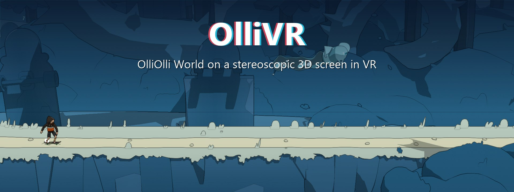
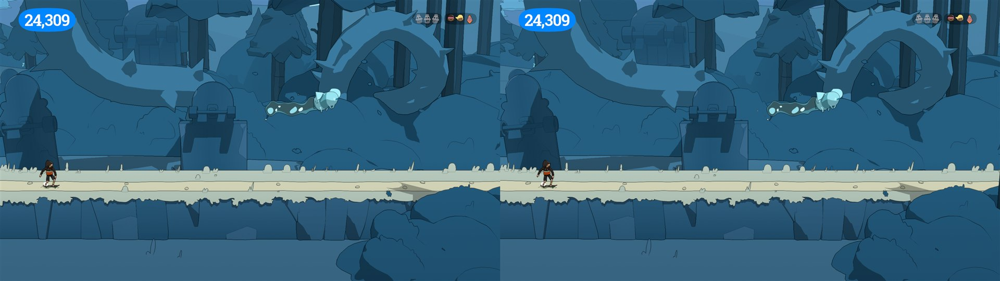

<p align="center"></p>

# OlliVR

A BepInEx 6 (IL2CPP) mod that puts **OlliOlli World** on a big stereoscopic 3D virtual screen in SteamVR. It works with the Steam Frame, Valve Index, Quest via Link or Virtual Desktop, and any other SteamVR headset. The game keeps its familiar side-on view, but now it has real depth. With **head-coupled perspective** ("fish tank VR") the screen acts like a window into the game world: lean or move your head and the view through it shifts. Play with a gamepad.

## Features
- **Real 3D depth.** Rails, ramps and scenery pop out of the screen or sit behind it, so you can judge gaps and landings by depth.
- **Look into the world.** Lean or move your head and the view shifts, as if the screen were a window into the game.
- **Steady depth.** Your skater always sits on the screen surface, so the 3D stays comfortable at speed.
- **A big screen in front of you.** Recenter any time with L3 + R3. Size, distance and depth strength are adjustable.

<p align="center"><br><sub>The side-by-side image the headset receives (left eye, right eye).</sub></p>

## Requirements
- OlliOlli World on Steam (Windows).
- SteamVR and a SteamVR-compatible headset.
- A gamepad.

## Installation
1. Download `OlliVR-vX.Y.Z-with-BepInEx.zip` from [Releases](../../releases).
2. Extract it into the game folder, for example `C:\Program Files (x86)\Steam\steamapps\common\OlliOlli World`, so that `winhttp.dll` and the `BepInEx` folder sit next to `OlliOlli World.exe`.
3. Start SteamVR, put on your headset, then launch OlliOlli World from Steam. The first launch takes a minute or two longer while BepInEx sets itself up.

The zip includes an unmodified [BepInEx](https://github.com/BepInEx/BepInEx) 6.0.0-be.793, IL2CPP win-x64 (LGPL-2.1, licence included). If you already use BepInEx in this game, extracting replaces its core files with be.793; your other plugins and configs are kept.

## Building from source
1. Install the release zip above and run the game once, so BepInEx generates its interop assemblies.
2. Install the [.NET SDK](https://dotnet.microsoft.com/download) (6.0 or newer), clone this repo and build it:
   ```powershell
   dotnet build -c Release -p:GameDir="C:\Program Files (x86)\Steam\steamapps\common\OlliOlli World"
   ```
   The build compiles against the game's BepInEx interop assemblies. It copies `OlliVR.dll` and `openvr_api.dll` (from your SteamVR install) into `BepInEx\plugins\OlliVR\`. If SteamVR is not in the default Steam library, add `-p:SteamVRDir="<path to SteamVR>"`. Add `-p:Deploy=false` to build without copying, for example while the game is running.

## Usage
- The screen appears about 2 m in front of you. It recenters when you put the headset on.
- **Recenter:** press **F8**, or hold **L3 + R3** on the gamepad for one second.
- Lean in, sideways or up and down to look around inside the screen.
- Settings live in `BepInEx\config\olliolliworld.vr.cfg`. The file is created on first launch.

| Setting | Default | What it does |
|---|---|---|
| `ScreenDistance` | 2.0 | Distance to the screen, in metres. |
| `ScreenScale` | 1.0 | Screen size. At 1.0 the screen covers exactly the game camera's field of view. |
| `ScreenHeightOffset` | 0 | Raise (+) or lower (−) the screen, in metres. |
| `RecenterKey` | F8 | Keyboard key that recenters the screen. |
| `DepthStrength` | 1.0 | Eye separation multiplier. Higher gives deeper 3D, 0 is flat. |
| `ConvergenceDistance` | 0 (auto) | Game-world distance that sits on the screen surface. Auto follows the skater, with a raycast through the view centre as fallback. |
| `HeadCoupled` | 1.0 | Fish-tank effect strength. 0 gives a fixed viewpoint, like a plain 3D TV. |
| `UncapFramerate` | true | Turns off the game's vsync and frame cap so SteamVR paces the frames. |
| `ReplaceTAA` | true | Replaces TAA with FXAA. |
| `DisabledEffects` | MotionBlur | Comma-separated post-processing effects to turn off, for example `MotionBlur,DepthOfField,Vignette`. |
| `FlipVertical` | true | Toggle this if the screen is upside down. |
| `VerboseLogging` | false | Logs camera, render and convergence diagnostics. |

## Troubleshooting
- **Nothing in the headset:** check `BepInEx\LogOutput.log` for lines starting with `OlliVR`. The mod keeps retrying to connect to SteamVR every few seconds, so starting SteamVR after the game also works.
- **Screen in the wrong place:** recenter with F8, or hold L3 + R3.
- **Too much or too little depth:** lower or raise `DepthStrength`. If the fish-tank effect feels uncomfortable, set `HeadCoupled` to 0.
- **Screenshots for bug reports:** create an empty file `BepInEx\OlliVR_capture.trigger`. The mod saves `BepInEx\OlliVR_capture_Stereo.png` within a second.

## Known issues
- Some shadows shimmer slightly in the headset.

## How it works
- The game keeps its cameras disabled and renders them by hand. The mod records, through `Camera.onPreCull`, which cameras rendered to the monitor each frame.
- At the end of each frame it renders those cameras again, once per eye. Each eye gets a generalised off-axis projection: the eye's real position, from SteamVR, looks through the screen rectangle. The screen maps to the game's image plane at the convergence distance, so objects at that distance sit on the screen surface.
- The screen's size and window come from the game camera's actual projection. Cinemachine frames the skater left of centre with `Camera.lensShift`, and the mod applies that shift to each eye's window as well.
- The game uses its own scriptable render pipeline (`Roll7.NoComplyRenderer`). A camera render there replaces its whole target and drops alpha, so nothing can be drawn over an eye image afterwards. Instead, the game's screen-space UI moves to the mod's orthographic UI camera, laid out exactly like overlay mode. Each eye image is placed as a full-screen background behind the UI, so a single UI render produces "eye + UI".
- Both eyes are combined into one side-by-side texture and shown on a SteamVR overlay with the `SideBySide_Parallel` flag. A dark backdrop is submitted as the scene, with frame pacing on Unity's render thread so the game never blocks on SteamVR.

## Uninstall
Delete `BepInEx\plugins\OlliVR`. To remove BepInEx completely, also delete `winhttp.dll` from the game folder.

## Credits
- [BepInEx](https://github.com/BepInEx/BepInEx) and Il2CppInterop.
- [OpenVR](https://github.com/ValveSoftware/openvr) by Valve (`src/OpenVR/openvr_api.cs`, BSD-3-Clause).
- OlliOlli World is made by Roll7 and published by Private Division. This is an unofficial fan mod, not affiliated with them.
